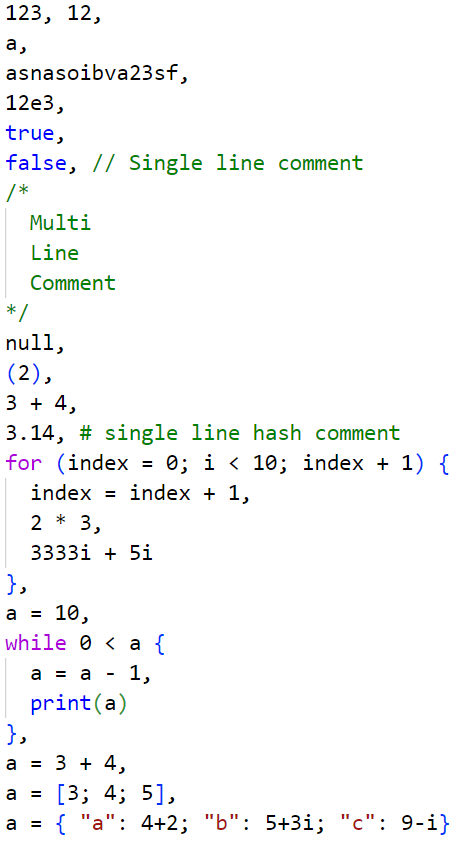
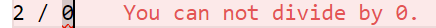
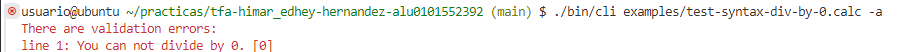
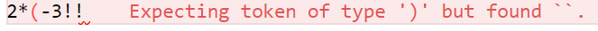
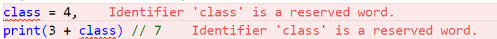
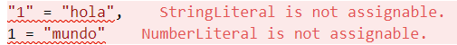
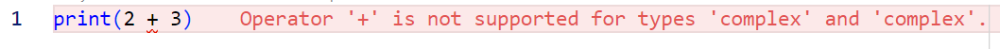
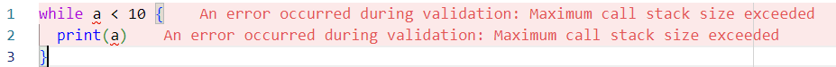
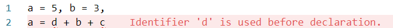

# TFA

[](https://classroom.github.com/open-in-codespaces?assignment_repo_id=19363861)

- **Author:** Himar Edhey Hernández Alonso
- **Subject:** Language Processing
- **Email:** <alu0101552392@ull.edu.es>
- **GitHub:** [Edhey](https://github.com/Edhey)

## Initial TFA Goals

The goal of my TFA project is to migrate the current calculator language transpiler into a fully Langium-based implementation. So we need to:

- Define the grammar for the calculator language using Langium.
- Build a Language Server Protocol that supports syntax highlighting, error detection, and basic validation in Visual Studio Code.
- Redo the JavaScript code generator to migrate the original functionality of converting calculator programs into executable JavaScript from recast to Langium.

In summary, with this project we will make a user-friendly environment for the calculator language, allowing users to write the code easily.

## Functionality

This project improves the [Old Calculator Language](https://github.com/Edhey/arith2js) by adding a new language server protocol (LSP) that allows for syntax highlighting, error detection, and basic validation in Visual Studio Code. The project also includes a new code generator that converts calculator programs into executable JavaScript using Langium.

## Code Generation

The code generation is based on the new AST generated by Langium. The code generator is responsible for converting the calculator programs into executable JavaScript. The code generation process involves traversing the AST and generating the corresponding JavaScript code for each node in the AST. The generated code is then executed using Node.js.

The idea was to generate the same code as the old calculator language, but it is not exactly the same. The code generated have another format and the tabs and spaces are not the same. The code generated run as expected in almost all cases, but the tests are not passing because of this. I couldn't manage to add a null node when calling a function with no arguments in the grammar, so, the code generated doesn't work when nesting multiple functions with no arguments, but it works when calling a function with no arguments just once. I will try to fix this in the future.

## Syntax Highlighting

The syntax highlighting is based on the TextMate grammar used by Langium. The syntax highlighting includes keywords, comments, strings and other language constructs as brankets. The keywords are highlighted in blue, comments are highlighted in green, strings are highlighted in orange and the rest of the code is highlighted in black.

There is an external script that is responsible for defining the syntax highlighting rules. The script uses the TextMate grammar to define the syntax highlighting rules for the calculator language. The syntax highlighting is applied to the code editor in Visual Studio Code.

There is an Example:



## Error Detection

The error detection is based on the validation system used by Langium. The error detection includes syntax errors, semantic errors and runtime errors. The syntax errors occur when the code is not valid according to the grammar. For example, if a variable is not defined or if a not possible operation is used. I used the validation system to define the rules for the error detection.
Zero Division Example:



Incorrect Syntax Example:



Also I implemented keywords errors for future reserved words as class:

Reserved Keywords Example:



Another implementation was to check if the assignments are valid. For example, a number cannot be assigned so a message as the next one should be shown:


Other idea was to detect the errors in the operations types for validation, as it is done in the monkey patch. For get errors like the next one:



So checking it the types of the operations are aviable in the operationHandler for the operator should be enoght to know is the operation is valid. For this I need to transpile new the types into the original ones , but for some reason the validation is not working as expected. It recognizes everything as an error. The implementation uses the operationsHandlers to check the types of the operations, as said, but I allways get undefined. Also I don't know how to debug the validation so I have no idea how to fix it. Furthermore, the next implementation should be accepting everything as a valid expression since the operationsHandlers are defining the defult values for all the operations. Anyway, it is not working as expected:

```javascript
  checkBinaryExpressionTypes(binExpr: BinaryExpression, accept: ValidationAcceptor): void {
    const leftType = this.inferType(binExpr.left);
    const rightType = this.inferType(binExpr.right);
    const operator = JavaScriptTranspiler.transpileOperator(binExpr.operator);
    try {
      // const operation = operationHandlers[leftType]?.[operator]?.[rightType]?`);
      const operation = lodash.get(operationHandlers, `${leftType}.${operator}.${rightType}`);
      console.log('operation', operation);
      if (!operation) {
        throw new Error();
      }
    } catch {
      accept('error', `Operator '${binExpr.operator}' is not supported for types '${leftType}' and '${rightType}'.`, {
        node: binExpr,
        property: 'operator'
      });
    }
  }
```

Another posibility is to define all the posible types in the grammar and then check it but I think it is not the best way to do it. It is not extensible and is really difficult to maintain. So I will focus on other implementations first.

Also I tried to cover the errors in bad variable usage, as using a variable before it is defined. This was difficult to implement since Langium doesn't provide any visitor pattern to traverse the AST. So You need to implement it by yourself. This was the initial aproach, but It didn't work as expected.

```javascript
/**
 * Recorre recursivamente el AST aplicando una función "visitor" a cada nodo.
 * @param node El nodo actual del AST.
 * @param visitor Función callback que se invoca en cada nodo.
 */
function traverseAst(node: any, visitor: (node: any) => void): void {
  if (!node || typeof node !== 'object') {
    return;
  }

  // Llamamos a la función visitor para el nodo actual.
  visitor(node);

  // Recorremos todas las propiedades del nodo.
  for (const key of Object.keys(node)) {
    const value = node[key];
    if (Array.isArray(value)) {
      // Si es un array, recorremos cada elemento.
      for (const element of value) {
        // Comprobamos que sea un posible nodo del AST (por ejemplo, que tenga $type)
        if (element && typeof element === 'object' && '$type' in element) {
          traverseAst(element, visitor);
        }
      }
    } else if (value && typeof value === 'object' && '$type' in value) {
      // Si es un objeto y tiene $type, se considera nodo y se recorre.
      traverseAst(value, visitor);
    }
  }
}
```

In my case I didn't have enough time to do it so I tried a kind of visitor pattern starting from a simple identifier finding. The idea is to traverse the AST and find all the identifiers in the code:

```javascript
  findIdentifiers(node: any): Set<string> {
    const identifiers = new Set<string>();
    if (node.$type === 'Identifier') {
      identifiers.add(node.name);
    } else if (Array.isArray(node)) {
      for (const item of node) {
        const childIdentifiers = this.findIdentifiers(item);
        childIdentifiers.forEach(id => identifiers.add(id));
      }
    } else if (node && typeof node === 'object') {
      for (const key in node) {
        const childIdentifiers = this.findIdentifiers(node[key]);
        childIdentifiers.forEach(id => identifiers.add(id));
      }
    }
    return identifiers;
  }
```

This was not working:



Finally, I managed It in other way without using the visitor pattern. I could traverse the AST and find variables used without declaration. So The implementation is not the best one, but it works as expected. I will try to improve it in the future.



## Testing

I used the vitest framework for testing the support library methods and it was not difficult at all. Also I tried to use the same tests as the old calculator language, but the code generation was not exactly the same as the recast one so transpile is not passing all the old tests. The difference are the , are transpiled in ; when dividing expressions and the parentification is not the same. But the run is passing in almost all cases. I had to change the tests for the could work now because using the CalcScriptService to run the code was not working as expected in test, so now I use the exec command to run the cli and then transpile or run the code. This makes the testing slower, but I didn't have time to implement a better solution. So I let the tests as they are now, not passing all the tests but I think this is a good way to now how much I could approach to the original calculator language. So transpile test are not really informative but run test are, so you can use npm run

### Coverage

The following table provides an overview of the test coverage for the project:

| File                                                              | % Stmts | % Branch | % Funcs | % Lines | Uncovered Line #s                                                            |
|-------------------------------------------------------------------|---------|----------|---------|---------|-----------------------------------------------------------------------------|
| All files                                                         |   93.21 |    92.32 |   73.33 |   93.21 |                                                                             |
| tfa-himar_edhey-hernandez-alu0101552392                          |   98.14 |    71.42 |     100 |   98.14 |                                                                             |
| esbuild.mjs                                                     |   98.14 |    71.42 |     100 |   98.14 | 50                                                                          |
| tfa-himar_edhey-hernandez-alu0101552392/out/cli                  |     100 |      100 |     100 |     100 |                                                                             |
| tempCode.js                                                     |     100 |      100 |     100 |     100 |                                                                             |
| tfa-himar_edhey-hernandez-alu0101552392/src/cli                  |    80.4 |    73.07 |      75 |    80.4 |                                                                             |
| cli-util.ts                                                     |   76.47 |    66.66 |   66.66 |   76.47 | 10-12,15-17,46-51                                                            |
| main.ts                                                         |   82.47 |    78.57 |     100 |   82.47 | 53-58,67-74,88-90                                                            |
| tfa-himar_edhey-hernandez-alu0101552392/src/code-generation      |   94.81 |    91.93 |   96.87 |   94.81 |                                                                             |
| support-lib.js                                                  |    92.8 |    70.58 |   83.33 |    92.8 | 81,86-87,100,105,119-123                                                     |
| transpile.ts                                                    |   95.73 |    95.32 |     100 |   95.73 | 123-128,171-173,196-197,226-227                                              |
| tfa-himar_edhey-hernandez-alu0101552392/src/function-object      |   74.61 |    82.45 |   43.18 |   74.61 |                                                                             |
| array-function-object.js                                        |   91.66 |       75 |   81.81 |   91.66 | 45-46,52-53,55-56,76-77,89-91                                                |
| function-object.js                                              |   96.07 |    88.88 |   85.71 |   96.07 | 38-39,69-70                                                                 |
| function-object.ts                                              |   52.33 |      100 |       0 |   52.33 | 29-33,36-37,40-41,44-45,55-61,64-92,102-105                                  |
| object-function-object.js                                       |     100 |      100 |      75 |     100 |                                                                             |
| object-function-object.ts                                       |   72.72 |      100 |       0 |   72.72 | 18-24,31-32,40-42                                                            |
| store-map.js                                                    |   51.38 |      100 |   16.66 |   51.38 | 25-32,35-41,45-51,55-62,65-69                                                |
| store-map.ts                                                    |   62.24 |      100 |       0 |   62.24 | 20-21,30-37,45-51,59-65,73-80,91-95                                         |
| tfa-himar_edhey-hernandez-alu0101552392/src/language             |   78.98 |    69.69 |   78.57 |   78.98 |                                                                             |
| calc-script-module.ts                                           |     100 |      100 |     100 |     100 |                                                                             |
| calc-script-validator.ts                                        |   70.55 |    71.42 |      75 |   70.55 | 77-81,87-89,115-130,134-135,139-155,158-164,169-170,173-174,183-184,187-188 |
| syntaxes-post-processing.js                                     |   86.66 |    33.33 |     100 |   86.66 | 21-22,29-30                                                                 |
| tfa-himar_edhey-hernandez-alu0101552392/src/language/generated   |   99.43 |    98.57 |   83.87 |   99.43 |                                                                             |
| ast.ts                                                          |    97.6 |      100 |   81.48 |    97.6 | 61-62,72-73,231-232,246-247,422-428                                         |
| grammar.ts                                                      |     100 |       50 |     100 |     100 | 10                                                                          |
| module.ts                                                       |     100 |      100 |     100 |     100 |                                                                             |
| tfa-himar_edhey-hernandez-alu0101552392/src/mokey-patch          |   93.61 |      100 |     100 |   93.61 |                                                                             |
| monkey-patch-handlers.js                                        |     100 |      100 |     100 |     100 |                                                                             |
| monkey-patch.js                                                 |   88.46 |      100 |     100 |   88.46 | 28-29,31-32,40-41                                                            |
| tfa-himar_edhey-hernandez-alu0101552392/src/mokey-patch/handlers |   91.92 |    97.29 |       0 |   91.92 |                                                                             |
| array-function-object-monkey-patch.js                           |   89.21 |      100 |     100 |   89.21 | 52-53,64,74,82,90-93,97,101                                                 |
| boolean-monkey-patch.js                                         |    96.2 |      100 |     100 |    96.2 | 49-50,78                                                                     |
| complex-monkey-patch.js                                         |   91.97 |      100 |     100 |   91.97 | 59-63,95,105-107,117,127,137,147                                             |
| function-monkey-patch.js                                        |   86.17 |      100 |     100 |   86.17 | 40,49-53,64,74,82,90-93                                                      |
| function-object-monkey-patch.js                                 |   96.11 |    93.75 |     100 |   96.11 | 53-54,83,102                                                                 |
| string-monkey-patch.js                                          |   92.19 |       95 |       0 |   92.19 | 57,78-82,91,136-139                                                         |
| tfa-himar_edhey-hernandez-alu0101552392/src/scope                |     100 |      100 |     100 |     100 |                                                                             |
| scope-class.js                                                  |     100 |      100 |     100 |     100 |                                                                             |

## Packaging

You can package the project using the following command:

```bash
vsce package
```

# Langium Calculator Experience

## Environment Setup

First of all I need to install the Langium CLI. I set up a new Langium project using the following command:

```bash
npm i -g yo generator-langium
yo --version
yo langium
```

Then I configured the project options for my calculator language (CalcScript). At this point, I needed to finally set up the project, Langium uses typescript, so the old calculator language code was not compatible at all with the new project. I needed to start from scratch transpiling some files into ts. That was not the big deal. Also Langium uses vitest for testing, In my opinion vitest is not bad at all, very similar to jest, but trying to run the jest tests in the new environment was a mess.

## Grammar Definition

Before I could start to define the grammar I need to read the Langium documentation. Langium uses a LL(k) parser, so the grammar was not similar at all to the jison grammar we used in the old calculator language (god save the jison grammar). This was a bit tricky, but I managed to define the grammar using the recomended level hierarchy appling the inferences in the rule. This way an after too many tries and hours I got the grammar working as well as I could avoiding the left recursion. So my final grammar is all Expression as the old one. the expressions are separated by a comma (,) and there are two main types of expressions:

- **AssignmentExpression**: This is the expression that assigns a value to a variable.
- **ControlExpression**: This is the expression that controls the flow of the program (like if, while, etc.).

```langium
Expression infers Expression:
  AssignmentExpression
  | ControlExpression
;
```

The assignment expression delegates to the next level rule and this one to the next one and so on. The root of the grammar are the PrimaryExpressions

```langium  
PrimaryExpression infers Expression:
  '(' Expression ')' 
  | NumberLiteral 
  | StringLiteral 
  | BooleanLiteral 
  | NullLiteral 
  | Identifier 
  | ArrayLiteral 
  | ObjectLiteral 
  | FunctionDeclaration
  | CallLiteral
;
```

Defining the Call as an Expression was the most difficult part. The recursion was giving me a lot of problems. I needed to define the CallExpression as an expression and then delegate to the next level and the CallLiteral as an PrimaryExpression. The grammar is a bit long, but I will not go into more details about it. The important part is that I managed to define the grammar and the parser was able to parse the code correctly.

## Syntax Highlighting

The syntax highlighting is not very difficult to implement but is not really useful that you need to define all in the grammar for highlighting. I defined keywords highlighting by using an external js script file as Langiums uses textMate for it. So now the keywords from the library support and other as fun, while, for, comment, etc. are highlighted.

## Error Detection

The error detection is not very difficult to implement. Langium uses a validation system that allows you to define the rules for the validation. I defined the rules for the calculator language as for using 0 in a division. I should add more for the scope of the variables, but time was running out and I don't expect to have it all done for the presentation. I will add more rules in the future.

## Code Generation

The code generation is the most difficult part of the project. I defined a kind of interpreter that transpiles the code into JavaScript. The code generation is based all on the new ast generated by Langium. So I needed to do it all from scratch. A good idea could be to trasform the ast into another recognized ast and then use recast to generate the code.

## Testing

I used the vitest framework for testing the support library method and it was not difficult at all. I tryed to use the same tests as the old calculator language, but the code generation was not exactly the same as the recast one. I didn't managed to print the same tabs and spaces to format the code so now the test are not passing. This doesn't mean that the code generation is not working, if you run the code with the new cli it works as expected.

## Cli and imports

The cli was not difficult to implement. Is very similar to the old one. In this case you need to use ts and use the services and parser from Langium. This generates a problem with the importation in the code generation. now require is not able to use, as well as eval. It couldn't be used in the same way as before. So now I used an external temporary file to store the code and then use the exec command to run the code in node. The importations are checked by the parser and the code generated only imports the libraries that are used in the code as in the original calculator.

## Packaging

Finally, the packaging was practically automatic. Using vsce to package the project and the extension generates the .vsix file that can be used to install the extension in Visual Studio Code.

## Conclusion

In conclusion, the project was a bit difficult to implement. I needed to learn a lot about Langium and how to use it. The documentation is not very extense, but I managed to find some examples that helped me a lot. Langium is not bad but It is not the think I expected. After all, I think that the project was a success. I learned a lot about new tools and how to use them and I managed to implement the project good enough to be able to use it.
